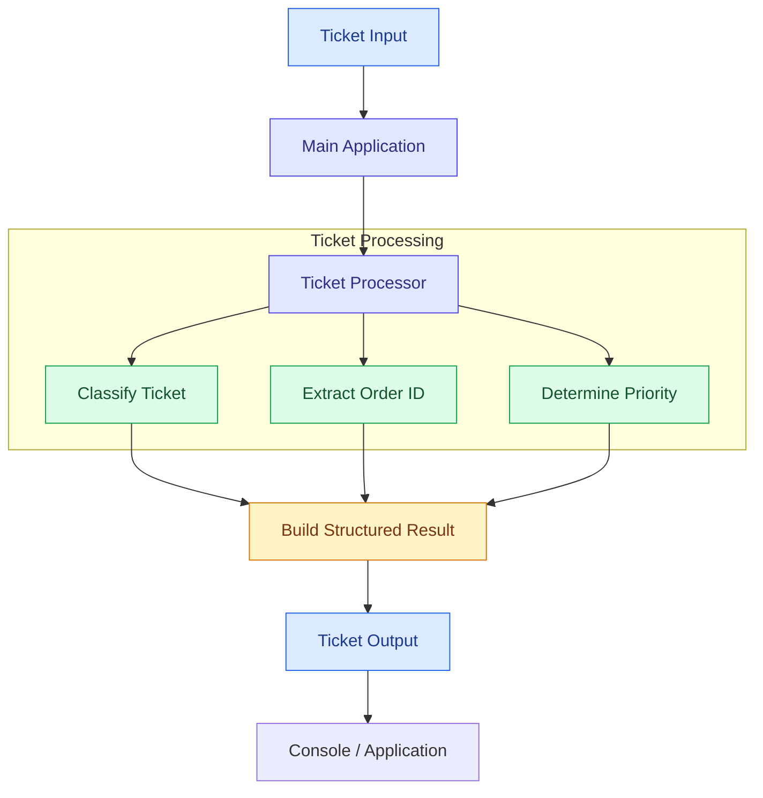
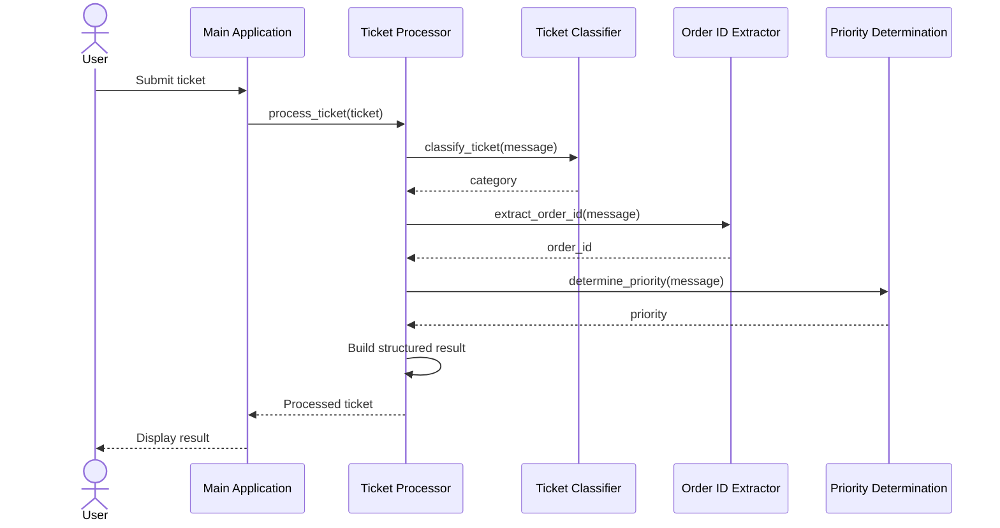

# Day 1 — Support Agent Architecture

## 1. Overview

### Purpose

Build a basic Python-based support ticket processing application.

The application receives a support ticket, extracts relevant information, determines its category and priority, and returns a structured result.

This is the initial foundation of the future AI Support Agent.

### Architecture Goals

- Keep the application simple and modular.
- Separate individual processing responsibilities.
- Use deterministic rule-based classification.
- Make components independently testable.
- Prepare the architecture for future AI integration.

## 2. Problem Statement

A customer support platform receives thousands of support tickets.

Each ticket must be processed to identify:

- Ticket ID
- Customer information
- Ticket category
- Order ID
- Priority
- Processing status

### Example Input

```json
{
  "ticket_id": 1001,
  "customer": "John",
  "message": "My order #4821 has not arrived.",
  "priority": "high"
}
```

### Expected Output

```json
{
  "ticket_id": 1001,
  "customer": "John",
  "category": "order_status",
  "order_id": "4821",
  "needs_order_lookup": true,
  "priority": "high",
  "status": "pending"
}
```

## 3. Architecture Style

**Architecture:** Modular Monolithic Application

The application is organized into independent functions with clearly defined responsibilities.

We are not introducing microservices, databases, APIs, or AI models at this stage.

### Why Modular Monolith?

- Simpler development.
- Lower operational complexity.
- Easy debugging.
- Easy unit testing.
- Suitable for learning fundamental software engineering concepts.

## 4. High-Level Architecture



## 5. Component Responsibilities

### 5.1 Main Application

**File:** `src/support_agent/main.py`

Responsibilities:

- Create or receive ticket input.
- Call the ticket processor.
- Display the processing result.
- Coordinate application execution.

### 5.2 Ticket Processor

**File:** `src/support_agent/ticket_processor.py`

Responsibilities:

- Coordinate ticket processing.
- Call the required processing functions.
- Combine extracted information.
- Return structured ticket data.

### 5.3 Ticket Classifier

**Function:** `classify_ticket()`

Responsibilities:

- Analyze ticket message.
- Apply classification rules.
- Determine the ticket category.

Initial categories:

| Category | Description |
|---|---|
| order_status | Order or delivery problems |
| refund | Refund requests |
| payment_issue | Payment problems |
| general | Other inquiries |

### 5.4 Order ID Extractor

**Function:** `extract_order_id()`

Responsibilities:

- Search ticket messages for order identifiers.
- Extract the identifier.
- Return `None` when no identifier exists.

Example:

Input:

```text
My order #4821 has not arrived.
```

Output:

```text
4821
```

### 5.5 Priority Determination

**Function:** `determine_priority()`

Responsibilities:

- Analyze ticket message.
- Apply priority rules.
- Return the calculated priority.

Initial priority levels:

- critical
- high
- normal

Note: The current implementation uses basic keyword matching. It is not a complete production priority policy.

### 5.6 Result Builder

The `process_ticket()` function currently combines the results into a dictionary.

Responsibilities:

- Collect classification results.
- Collect extracted identifiers.
- Include ticket metadata.
- Return the final structured result.

## 6. Processing Sequence



## 7. Data Model

### Input Model

| Field | Type | Required | Description |
|---|---|---|---|
| ticket_id | int | Yes | Unique ticket identifier |
| customer | str | Yes | Customer name |
| message | str | Yes | Ticket description |
| priority | str | No | Provided priority |

### Output Model

| Field | Type | Description |
|---|---|---|
| ticket_id | int | Ticket identifier |
| customer | str | Customer name |
| category | str | Classified category |
| order_id | str or None | Extracted order identifier |
| needs_order_lookup | bool | Indicates whether order lookup is required |
| priority | str | Ticket priority |
| status | str | Processing status |

## 8. Business Rules

### Rule 1 — Ticket Classification

- Message containing `order` or `delivery` → `order_status`
- Message containing `refund` → `refund`
- Message containing `payment` → `payment_issue`
- Otherwise → `general`

### Rule 2 — Order ID Extraction

- Extract numeric identifiers prefixed with `#`.
- Return `None` if no matching identifier exists.

### Rule 3 — Priority

- Message containing `urgent` → `critical`
- Message containing `refund` → `high`
- Otherwise → `normal`

### Rule 4 — Order Lookup

- If an order ID is extracted, `needs_order_lookup = true`.
- Otherwise, `needs_order_lookup = false`.

### Rule 5 — Processing Status

Newly processed tickets receive the initial status `pending`.

## 9. Error Handling

The initial implementation should eventually handle:

| Scenario | Expected behavior |
|---|---|
| Missing ticket ID | Reject ticket |
| Missing message | Reject ticket |
| Empty message | Reject ticket |
| Missing customer | Apply defined fallback or reject |
| Unknown priority | Normalize or reject |
| Missing order ID | Continue processing |
| Unexpected input type | Reject invalid input |

These validations are architectural requirements for the next implementation improvement, not all features of the initial Day 1 code.

## 10. Testing Strategy

Use pytest.

### Unit Tests

Test individual functions independently.

- `test_classify_order_ticket`
- `test_extract_order_id`
- `test_extract_missing_order_id`
- `test_determine_priority`

### Integration Tests

Test the complete processing flow.

- `test_process_ticket`
- `test_process_ticket_without_order_id`

### Expected Quality Attributes

- Deterministic results.
- Independent component testing.
- Readable code.
- Predictable error handling.

## 11. Technology Stack

| Technology | Purpose |
|---|---|
| Python | Application development |
| uv | Dependency and project management |
| pytest | Automated testing |
| Ruff | Linting and formatting |
| Git | Version control |

## 12. Design Decisions and Trade-offs

| Decision | Reason | Trade-off |
|---|---|---|
| Python | Strong AI ecosystem | Runtime performance may be lower than compiled languages |
| Modular monolith | Simplicity and maintainability | Not independently deployable components |
| Functions | Small, testable responsibilities | More function calls and interfaces to maintain |
| Rule-based classification | Deterministic and easy to understand | Limited semantic understanding |
| Dictionary output | Simple structured result | No runtime schema validation |
| In-memory processing | Avoid infrastructure complexity | No persistence |

## 13. Current Limitations

The current system is a learning prototype.

It does not yet include:

- Database persistence.
- REST API.
- Authentication and authorization.
- External order lookup.
- Machine learning classification.
- LLM integration.
- Logging and monitoring.
- Retry and timeout mechanisms.
- Asynchronous processing.

These capabilities will be introduced progressively in later learning stages.

## 14. Future Architecture Evolution

The architecture will evolve as the learning project progresses.

| Stage | Architecture evolution |
|---|---|
| Day 1 | Basic Python processing functions |
| Day 2–6 | Better data structures, models and validation |
| Day 7–11 | Clean architecture and SOLID |
| Day 19–24 | PostgreSQL persistence |
| Day 25–29 | FastAPI REST interface |
| Day 30–34 | Testing, async and observability |
| Day 35–39 | Docker and data pipelines |
| Later AI phases | ML, LLMs, RAG and agent orchestration |

## 15. Day 1 Completion Criteria

- [ ] Python project initialized.
- [ ] Ticket processor implemented.
- [ ] Classification function implemented.
- [ ] Order ID extraction implemented.
- [ ] Priority determination implemented.
- [ ] Structured output generated.
- [ ] Unit tests written and passing.
- [ ] Architecture documented.
- [ ] Git changes committed.

## 16. Git Commit

```bash
git add .
git commit -m "docs(support-agent): document day 1 architecture"
```

---

**Architecture status:** Initial implementation — Day 1.

**Next:** Day 2 — Python Data Structures for AI Engineering.
